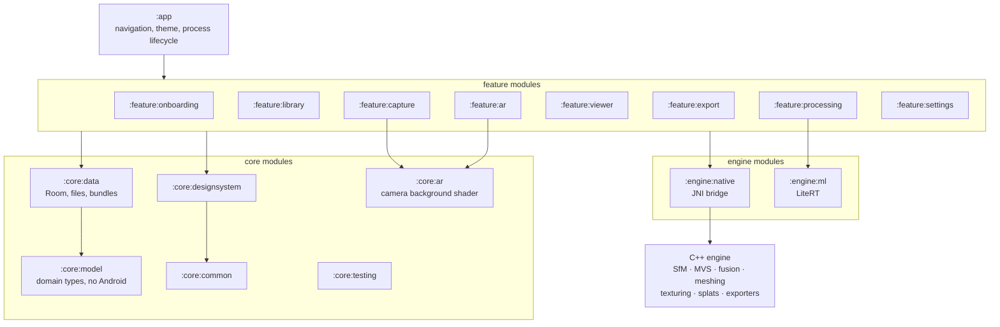
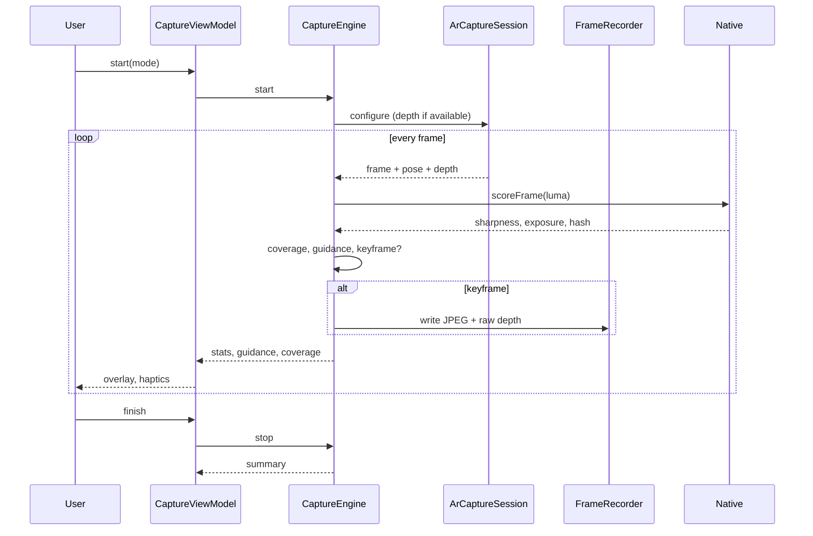
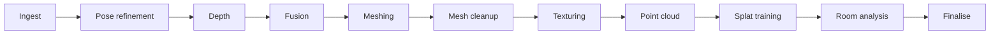
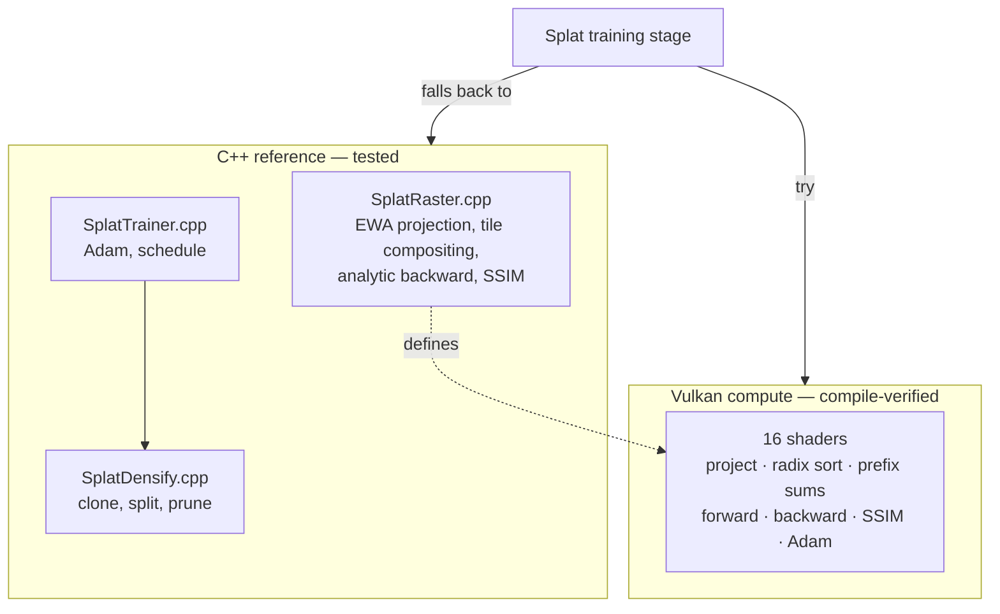
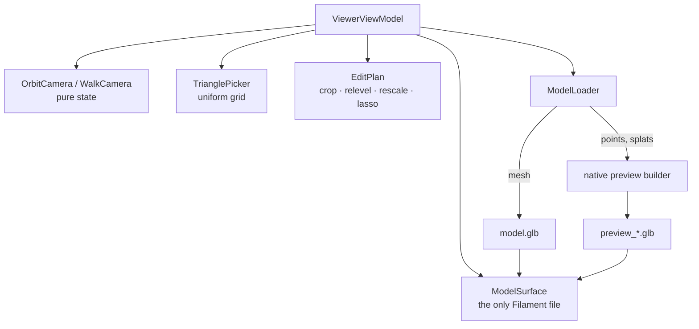
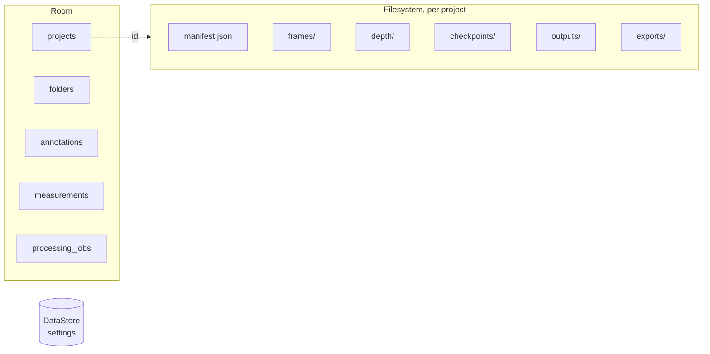

# Architecture

Parallax turns a few hundred photographs into a measured 3D model, entirely on
the phone. This describes how it is put together and, more usefully, why it is
put together that way.

One idea runs through all of it: **the parts that cannot be tested here are kept
as small as possible, and everything else is pushed into code that can be.**
There is no GPU, no camera and no ARCore in CI, so a design that spreads
camera-dependent logic across five files is a design where most of the app is
unverifiable. ARCore lives behind one session class, Filament behind one
renderer, Vulkan behind one trainer. The camera feel, the guidance, the
measuring, the edits, the pipeline, the exporters — all of that is ordinary code
with tests.

---

## The shape of it

**Dependencies point one way.** Features depend on core, core depends on model,
and nothing depends on a feature. Two features never depend on each other: when
the library needed to decide what tapping a scan does — open it, show the queue,
resume a capture — that decision went into `:app` as `ProjectLauncherViewModel`
rather than making `:feature:library` depend on `:feature:processing`.

`:core:model` has no Android dependency at all. It is where the domain lives —
capture modes, quality presets, project status, measurements, export formats —
and keeping it a plain Kotlin library is what lets its rules be tested without a
Robolectric runtime.

`:core:ar` exists for exactly one file. Capture and AR placement both have to
draw the camera feed under their own content, and that is one shader either way;
everything else about the two sessions differs enough that sharing them would be
a pile of flags.

---

## Capture

**Keyframe selection is the quality control.** A scan is only as good as the
frames kept, and keeping everything is worse than keeping the right subset:
blurry frames drag the bundle adjustment, and near-duplicates add cost without
adding parallax. A frame is kept when it adds parallax, rotation or coverage,
is sharp enough, and is not a perceptual duplicate of one already held.

**Guidance is a pure function.** Inputs — tracking state, coverage, sharpness,
speed, thermal and battery state — go in, one prompt comes out, with hysteresis
so prompts do not flicker. That makes it testable, and it is tested: priority
ordering, the hold time, and the cases where the right answer is silence.

**Coverage** is a sphere of azimuth × elevation bins, which is also the ring on
screen. Gaps are classified into language — underside, top, back, sides — from
the middle rows only, because top and bottom rows that wrap all the way round
would otherwise hide a missing side.

---

## Reconstruction

Eleven stages, each checkpointed to disk. Android will kill a background
service, and a twenty-minute reconstruction that restarts from zero is one
nobody waits for twice. On resume the pipeline finds the first stage without a
checkpoint and continues from there.

| Stage | What it does |
|---|---|
| Ingest | Read the manifest, decode frames, select keyframes |
| Pose refinement | Bundle adjustment over device poses, or full SfM when there are none |
| Depth | Sensor depth, else monocular depth scaled to metric, else multi-view stereo |
| Fusion | Integrate depth into a sparse TSDF volume |
| Meshing | Marching tetrahedra over the zero level set |
| Mesh cleanup | Decimate, fill holes, remove debris, level to the floor |
| Texturing | Choose views per triangle, pack an atlas, blend seams |
| Point cloud | Extract and colour surface points |
| Splat training | Gradient descent over 3D Gaussians, GPU where possible |
| Room analysis | Detect walls and openings, build a floor plan |
| Finalise | Write `model.glb` and record the measurements |

**Depth comes from whichever of three sources the device can offer.** ARCore's
depth API when there is one; otherwise Depth Anything V2 Small through LiteRT,
fitted to metric scale by RANSAC in *inverse* depth, which is where the
relationship is linear; otherwise the engine's own plane-sweep multi-view
stereo. The third tier is what makes the app work on a device with no depth
sensor and no model on disk, and it is why reconstruction never depends on a
download.

**The queue is one worker, not one per scan.** Reconstruction is memory- and
thermally-bound, so two running at once is slower than two in sequence and far
likelier to be killed — and one notification saying "2 of 4" is what a person
expects rather than four competing ones.

---

## Gaussian splatting

The mathematics is written twice, and the version that can be tested defines
the other.

Every gradient in the reference is checked against central differences, scored
with a linear functional of the pixels rather than L1 so the objective is
smooth and the check tests the rasteriser rather than the loss. The trainer is
checked by holding a camera out of the training set and requiring the error on
that unseen view to halve — a claim about geometry, not about memorising the
training images.

The shaders are compiled to SPIR-V by `glslc` as part of every build, host
included, so a shader that stops compiling breaks CI. None of them has ever been
executed, and none can be here, which is why a device that cannot run them falls
back to the reference on a reduced schedule rather than losing the feature.
ADR-009 records that boundary.

---

## Viewer

**Points and splats are drawn as triangles.** A point cloud becomes one small
disc per point facing that point's normal; a splat field becomes two triangles
per gaussian across its widest axes with a baked radial falloff. Both are built
by the native engine and loaded through the same GLB path as the mesh.

That is a deliberate trade (ADR-013). Drawing either properly needs a custom
Filament material compiled by `matc` at build time — another tool in the chain,
and a shader that could not be checked anywhere here. Converting them to
triangles puts the interesting work (disc sizing from local point spacing,
which of a gaussian's axes to keep, the falloff ramp) in code with unit tests,
and leaves the renderer with nothing to get wrong.

**Edits are intent, not geometry.** "Crop to this box", "rescale so this
measurement is really 2.4 m". The scan is never rewritten, so a crop made today
can be undone next month, an export can choose whether to apply the edits, and
a reprocessed scan inherits them.

---

## Where the data lives

**Metadata in the database, binaries on disk.** A row holds what the library
needs to draw a card without touching a file; the frames, checkpoints and
outputs are files because they are large, written by native code, and must
survive the database being rebuilt. `ProjectStorage` owns the directory layout,
and that layout is a contract with `Pipeline.cpp` — the one place where the two
languages have to agree about anything other than JSON.

**Nothing leaves the device.** The app has no `INTERNET` permission, so this is
not a policy but a property of the build: there is no code path that could
upload a scan, because the platform would refuse the socket. Sharing is the
system share sheet, over a `FileProvider` scoped to one staging directory, so a
share grant reaches the exported file and nothing else.

---

## Threading

| Where | What runs there |
|---|---|
| Main | Compose, ViewModels, state |
| `Default` | Guidance, coverage, keyframe scoring |
| `IO` | Database, files, bundles, exports |
| Reconstruction (single thread) | The native pipeline, one stage at a time |
| GL / render threads | Filament's own thread, ARCore's GL thread |
| Native workers | Bundle adjustment, MVS, fusion, splat training |

Reconstruction has a dispatcher of its own with one thread, which is a
deliberate limit rather than an oversight. The native stages are already
internally parallel and memory-bound; running two stages at once would compete
for the same bandwidth and double the peak footprint, which is what gets a
foreground service killed.

---

## What is tested, and what cannot be

337 native assertions and 386 JVM tests run on every build, alongside detekt,
Android Lint, R8 minification and screenshot comparison.

What cannot be tested here, and how the design limits the damage:

| Not testable | Contained in | What happens if it is wrong |
|---|---|---|
| ARCore tracking, depth, planes | `ArCaptureSession`, `ArPlacementSession` | Failures are classified into messages a person can act on; import and processing are unaffected |
| Camera capture | `FrameRecorder` | — |
| Filament rendering | `ModelSurface` | A renderer that refuses to start is a state the viewer handles; measurements and export still work |
| Vulkan compute | `VulkanSplatTrainer` + shaders | Falls back to the tested CPU trainer on a shorter schedule |
| LiteRT inference | `MonocularDepthEstimator` | Falls back to multi-view stereo |
| Real-device frame rates and thermals | — | Macrobenchmarks exist for a device to run |

`PROGRESS.md` keeps the same list under "verification boundaries", with the
per-phase record of what the tests actually caught.

---

## Reading further

- [DECISIONS.md](DECISIONS.md) — the fourteen decisions that shaped this, each
  with what it cost.
- [../PROGRESS.md](../PROGRESS.md) — what was built phase by phase, and the
  bugs each phase's tests caught.
- [LICENSES.md](LICENSES.md) — every dependency and its licence.
